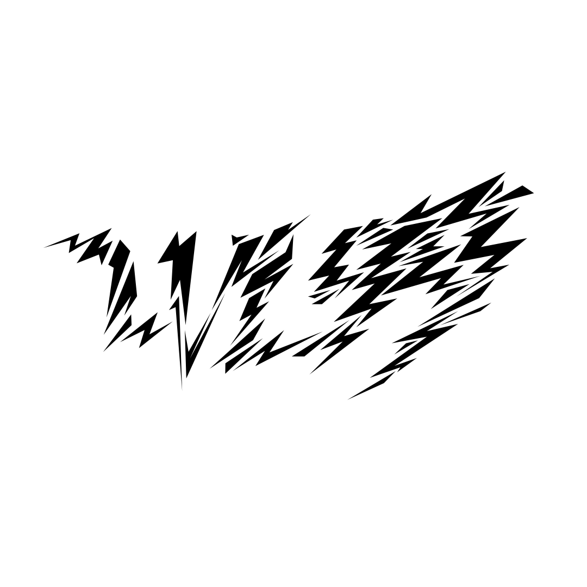

<!--yaml
status: draft
date: 2026-11-24T23:09:36.157Z
-->

# Article Styling Reference

This is a way to test out how everything looks in the editor and compare with the default theme via preview.

<!-- readmore -->

<!-- embed:toc -->
<!--yaml
level1: number
level2: number-depth
level3: number-depth
level4: alpha
level5: number-roman
level6: circle
-->
## Table of contents
<!-- /embed:toc -->

# H1 header

Lorem ipsum dolor sit amet, consectetur adipiscing elit. Maecenas quis blandit enim. Nam consectetur ante id orci condimentum gravida. Suspendisse et metus quis nulla varius lobortis vel eu tortor. Aliquam pharetra tortor lacus, fermentum venenatis metus gravida nec. Aenean id hendrerit magna, eget scelerisque sem. Aenean volutpat placerat urna, a hendrerit odio tristique quis. In arcu odio, pulvinar eget fringilla et, pretium non arcu. Vivamus in rhoncus libero.

- Example bullet list item 1
- Example bullet list item 2
- Example bullet list item 3

<!-- embed:youtube -->https://www.youtube.com/watch?v=aju_UB5VIf8<!-- /embed:youtube -->

## H2 header

Ut mollis tempus ullamcorper. Curabitur sodales gravida posuere. Quisque a lacus a nisi tempus vestibulum sed vulputate tellus. In malesuada volutpat sem, eget laoreet urna porttitor nec. Etiam arcu risus, porttitor ac congue in, dignissim ut nisl. Duis vitae lectus sit amet urna congue mattis id sit amet dui. Pellentesque finibus ex dui, sed blandit massa pretium vitae. Quisque auctor diam mi, at accumsan magna volutpat nec. Class aptent taciti sociosqu ad litora torquent per conubia nostra, per inceptos himenaeos. Morbi consectetur tortor nec mauris aliquam congue. Fusce sagittis ante vitae turpis egestas, id ullamcorper velit euismod.

1. Example numbered list item 1
2. Example numbered list item 2
3. Example numbered list item 3

<!-- embed:bandcamp -->
<!--yaml
layout: large
size: large
tracklist: false
transparent: true
bgcol: ffffff
linkcol: 0687f5
-->
https://672354.bandcamp.com/album/void-ep-1
<!-- /embed:bandcamp -->

### H3 header

Etiam feugiat, nisi varius eleifend fermentum, est nunc elementum lorem, ut sagittis erat magna ut libero. Sed finibus venenatis aliquet. Phasellus rhoncus erat vulputate diam varius accumsan. Praesent interdum justo egestas risus euismod dignissim. Morbi maximus lacinia libero in sollicitudin. Duis egestas iaculis nisi. Mauris commodo luctus odio rhoncus tempor. Fusce sit amet diam purus.

> Here's a fun quote that could be nice to show to all the people over there.

<!-- embed:mermaidjs -->
flowchart TD
    A[Christmas] -->|Get money| B(Go shopping)
    B --> C{Let me think}
    C -->|One| D[Laptop]
    C -->|Two| E[iPhone]
    C -->|Three| F[fa:fa-car Car]
<!-- /embed:mermaidjs -->

```
Here's some code
```

<details>
<summary>Here's an accordion</summary>

And here's the text for the accordion.

</details>

---

<!-- raw -->
<html><body></body></html>
<!-- /raw -->

| LOL | LMAO | ROFL |
| --- | --- | --- |
| 😀 | 😂 | 🤣 |

<!-- embed:codehighlight -->
<!--yaml
lineNumbers: true
syntaxHighlight: true
copyButton: true
-->
```ts
// Typescript
```

```js
// Javascript
```

```sql
# SQL
```

```sh
echo "Hello world!"
```
<!-- /embed:codehighlight -->


